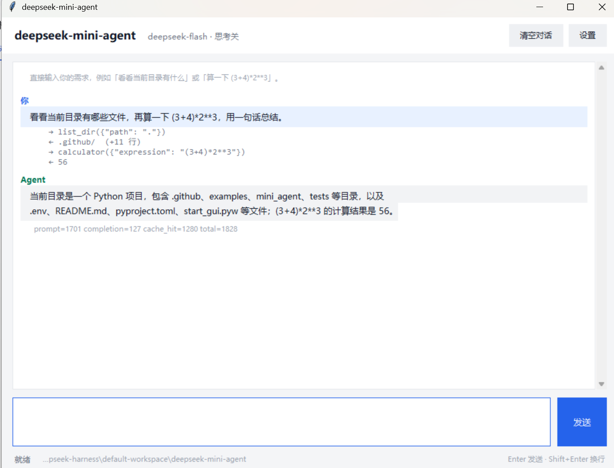

# deepseek-mini-agent

用约 140 行 Python 标准库代码实现一个完整的 agent loop，把 **DeepSeek-V4.1-Flash**（API 模型 id：`deepseek-flash`）变成一个能读写文件、做精确计算、带桌面界面的本地小助手。

- 零第三方依赖：只用 `urllib`、`dataclasses`、`tkinter` 等标准库
- 多种用法：终端 REPL、一次性命令、Tkinter 桌面窗口，也可以作为 Python 库调用
- 78 项测试，全部离线可跑，不需要 API key

---

## 这个项目解决什么问题

调用大模型 API 通常只能「一问一答」。但真实任务往往需要多步：

- 想知道目录里有什么，得先列目录
- 要算精确的算术，模型本身不可靠，得调用计算器
- 算完还要把结果写进文件，再读回来确认

这些「模型自己做不到、需要外部动作」的部分，正是 agent 要解决的。本项目实现了最小闭环：

1. 把可用工具的描述发给模型
2. 模型决定调用哪个工具、传什么参数
3. 程序在本地执行工具，把观察结果回填给模型
4. 重复以上步骤，直到模型不再调用工具，给出最终回答

它适合：

- 想搞懂 agent loop 到底怎么写的人——核心逻辑只有一个文件，没有框架魔法
- 需要一个本地文件 / 计算小助手的人——CLI 和桌面界面开箱即用
- 想拿一个干净骨架做二次开发的人——工具、模型、UI 都是可替换的外壳

它**不**解决：联网搜索、RAG、多 agent 协作、密钥托管。这些需要自己扩展。

---

## 主要功能

- **完整 agent loop**：一轮内可并行调用多个工具、`max_steps` 防死循环、工具异常回填、Ctrl-C 中断后自动修复历史
- **流式输出**：自己解析 SSE，文本边生成边显示；`tool_calls` 的分片参数会被正确拼回完整 JSON
- **5 个内置工具**：读文件、写文件、列目录、安全计算器、当前时间
- **路径沙箱**：所有文件操作限制在工作目录内，`../` 逃逸会被拒绝
- **两种界面**：终端 REPL，或 Tkinter 桌面窗口（含设置面板）
- **多种用法**：交互式 REPL、一次性 `-p`、桌面界面、作为 Python 库调用
- **可读的错误**：401 / 402 / 429、模型 id 错误都会给出下一步提示
- **自动重试**：429 和 5xx 默认重试，最多 3 次
- **token 统计**：每轮显示 prompt / completion / cache hit / total
- **可测试**：假模型 + 本地假 HTTP 服务 + 真子进程 CLI + 界面冒烟测试

---

## 安装

### 1. 准备 Python

需要 Python 3.10 或更高：

```bash
python --version
```

Windows 上如果提示找不到 Python，去 [python.org](https://www.python.org/downloads/) 安装，安装时勾选 **Add python.exe to PATH**。

### 2. 获取代码

```bash
git clone https://github.com/<your-name>/deepseek-mini-agent.git
cd deepseek-mini-agent
```

没有 git 也可以直接在 GitHub 页面点 **Code → Download ZIP**，解压后进入目录。

### 3. 配置 API key

1. 打开 <https://platform.deepseek.com>，登录后进入 **API keys**
2. 点「创建 API key」，起个名字（例如 `mini-agent`）
3. **立刻复制**弹窗里的 `sk-...` 完整字符串（只显示一次，关掉就找不回）
4. 复制配置模板并填入：

```bash
# macOS / Linux
cp .env.example .env

# Windows PowerShell
Copy-Item .env.example .env
```

编辑 `.env`：

```dotenv
DEEPSEEK_API_KEY=sk-你的key
DEEPSEEK_MODEL=deepseek-flash
```

> `.env` 要放在你运行命令的目录下。它已在 `.gitignore` 里，不会被提交。
>
> `deepseek-flash` 是 **DeepSeek-V4.1-Flash 的 API 模型 id**；`DeepSeek-V4.1-Flash` 只是展示名，写成 `deepseek-v4.1-flash` 会报 `model not found`。

### 4. 验证安装

```bash
python -m mini_agent --models
```

预期输出（顺序可能不同）：

```text
deepseek-flash
deepseek-v4-pro
```

看到模型列表，说明 key 和网络都正常。本项目不需要 `pip install`，也没有第三方依赖。

Linux 如果启动界面时提示缺少 tkinter，安装 `python3-tk` 即可；命令行用法不受影响。

---

## 使用方法

### 图形界面

```bash
python -m mini_agent --gui
```

Windows 也可以直接双击 `start_gui.pyw`（用 pythonw 运行，不会弹出控制台）。

- **对话区**：你的消息是蓝色块，agent 回答是灰色块，工具调用以小字显示「参数 → 结果」
- **右上角「设置」**：修改 API key、模型、工作目录、深度思考开关，保存后立即生效
- **右上角「清空对话」**：清空历史，设置保留
- **输入框**：`Enter` 发送，`Shift+Enter` 换行
- **底部状态栏**：当前状态和工作目录；每轮 token 用量显示在回答下方
- 首次启动如果没检测到有效 key，会自动弹出设置窗口

### 终端交互

```bash
python -m mini_agent
```

进入后直接用自然语言提需求。REPL 内命令：

| 命令 | 作用 |
| --- | --- |
| `/help`、`/?` | 显示帮助 |
| `/reset` | 清空对话历史（保留 system prompt） |
| `/history` | 打印当前消息历史 |
| `/exit`、`/quit`、`/q` | 退出 |

### 一次性执行

适合脚本或管道：

```bash
python -m mini_agent -p "用 calculator 算一下 (3+4)*2**3"
python -m mini_agent -p "读一下 README.md 的前 20 行" --no-stream
```

### 命令行参数

| 参数 | 说明 |
| --- | --- |
| `-p, --prompt TEXT` | 一次性执行这句指令，打印结果后退出 |
| `--gui` | 启动图形界面（Tkinter） |
| `-m, --model TEXT` | 模型 id，默认取 `DEEPSEEK_MODEL` 或 `deepseek-flash` |
| `--base-url TEXT` | API 地址，默认 `https://api.deepseek.com` |
| `--workspace PATH` | 工具可读写的工作目录，默认当前目录 |
| `--max-steps N` | 单轮最多调用模型次数，默认 20 |
| `--temperature F` | 采样温度，默认 0.7（思考模式下无效） |
| `--thinking MODE` | 深度思考：`disabled`（默认）/ `enabled` / `auto` |
| `--no-stream` | 关闭流式输出 |
| `--models` | 列出该 API key 可用的模型 id 后退出 |
| `-v, --verbose` | 显示完整工具参数与结果 |
| `--no-color` | 禁用彩色输出 |
| `--version` | 显示版本号 |

### 环境变量

写在 `.env` 或系统环境变量里。命令行参数优先级最高；如果 `.env` 里设置了 `MINI_AGENT_WORKSPACE`，它会覆盖「当前目录」这个默认值。

| 变量 | 默认值 | 说明 |
| --- | --- | --- |
| `DEEPSEEK_API_KEY` | 无（必填） | API key |
| `DEEPSEEK_MODEL` | `deepseek-flash` | 模型 id |
| `DEEPSEEK_BASE_URL` | `https://api.deepseek.com` | API 地址 |
| `MINI_AGENT_WORKSPACE` | 当前目录 | 工具工作目录 |
| `MINI_AGENT_MAX_STEPS` | `20` | 单轮步数上限 |
| `MINI_AGENT_TEMPERATURE` | `0.7` | 采样温度 |
| `MINI_AGENT_TIMEOUT` | `120` | 单次请求超时（秒） |
| `MINI_AGENT_STREAM` | `1` | `1` 流式，`0` 关闭 |
| `MINI_AGENT_THINKING` | `disabled` | `disabled` / `enabled` / `auto` |

### 作为库调用

```python
from mini_agent import Agent, DeepSeekClient, Settings, default_tools

settings = Settings.from_env()
agent = Agent(
    llm=DeepSeekClient(settings),
    tools=default_tools(settings.workspace),
    max_steps=10,
)

answer = agent.run("把当前目录的文件名整理成一行", on_text=print)
print(agent.history)        # 完整多轮消息，包含工具调用与观察结果
```

完整示例见 [`examples/one_shot.py`](examples/one_shot.py)。

---

## 输入输出示例

以下输出均来自真实运行。token 数会随上下文和模型状态略有浮动。

### 1. 列出目录并总结

输入：

```text
你 › 看看当前目录里有哪些文件？
```

输出（省略启动横幅、部分文件与末尾的 `/exit`）：

```text
  → list_dir({"path": "."})
  ← .github/  …(+10 行)
当前目录内容如下：

**目录**
- `.github/`
- `examples/`
- `mini_agent/`
- `tests/`

**文件**
- `.env.example`
- `README.md`
- `pyproject.toml`
- `start_gui.pyw`
…
  [tokens] prompt=1619 completion=164 cache_hit=1152 total=1783
```

### 2. 精确计算

```bash
python -m mini_agent -p "用 calculator 算 (3+4)*2**3，只回答结果。"
```

```text
  → calculator({"expression": "(3+4)*2**3"})
  ← 56
56
  [tokens] prompt=1588 completion=44 cache_hit=1152 total=1632
```

### 3. 写文件并读回

```bash
python -m mini_agent --workspace demo -p "创建 hello.txt，内容写 'agent loop ok'，再读回来确认。"
```

```text
  → write_file({"path": "hello.txt", "content": "agent loop ok"})
  ← 已写入 13 个字符到 hello.txt
  → read_file({"path": "hello.txt"})
  ←     1| agent loop ok
已创建 hello.txt，写入内容为 `agent loop ok`（13 个字符），读回确认内容一致。
  [tokens] prompt=2510 completion=119 cache_hit=1792 total=2629
```

### 4. 图形界面



### 5. 工具出错时会怎样

工具报错不会让程序崩溃，而是作为观察结果回给模型，由它决定重试还是换方案：

```text
  → read_file({"path": "nope.txt"})
  ← 错误：工具 read_file 执行失败：FileNotFoundError: 文件不存在：nope.txt
工作目录里没有 nope.txt 这个文件，读取失败（FileNotFoundError）。

要不要我先列一下当前目录，看看实际有哪些文件？
```

### 6. 常见错误输出

key 无效时：

```text
$ python -m mini_agent --models
获取模型列表失败：HTTP 401：Authentication Fails ...（key 无效、已删除或没被读到，请检查 .env 里的 DEEPSEEK_API_KEY）
```

余额不足时：

```text
模型调用失败：HTTP 402：Insufficient Balance（账户余额不足，请到 platform.deepseek.com 充值）
```

---

## Agent loop 是怎么转的

整个程序只有一件事在循环：**问模型 → 执行工具 → 把结果喂回去 → 再问**。

```text
             ┌──────────────────────────────┐
             │  history: [...]               │
             │   system / user / assistant   │
             │   / tool                      │
             └──────────────┬───────────────┘
                            │ 1. POST /chat/completions（带 tools schema）
                            ▼
                    ┌───────────────┐
                    │ deepseek-flash│
                    └───────┬───────┘
                            │ 2. assistant 消息
                ┌───────────┴───────────┐
                │                       │
        没有 tool_calls            有 tool_calls
                │                       │
                ▼                       ▼
          返回最终回答        3. 逐个执行工具（沙箱内）
                                        │
                                        ▼
                             4. 追加 role=tool 消息
                                        │
                                        └──► 回到 1，直到收敛
```

对应到 [`mini_agent/loop.py`](mini_agent/loop.py) 的核心逻辑（简化示意）：

```python
for step in range(1, self.max_steps + 1):
    result = self.llm.chat(self.history, tools=tools)
    self.history.append(result.to_message())

    if not result.tool_calls:          # 收敛：这就是最终回答
        return result.content

    for call in result.tool_calls:     # 执行并回填
        name = call["function"]["name"]
        observation = self.tools.execute(name, call["function"]["arguments"])
        self.history.append({
            "role": "tool",
            "tool_call_id": call["id"],
            "content": observation,
        })
```

三个关键点：

1. **`max_steps` 是刹车**：模型可能反复调同一个工具，超过步数就抛 `StepLimitExceeded`，不会死循环烧钱
2. **工具异常是数据，不是崩溃**：`read_file` 遇到不存在的文件返回 `错误：FileNotFoundError: ...`，模型下一轮会据此修正
3. **历史必须成对**：每个 `tool_calls` 都要有对应的 `tool` 消息；用户 Ctrl-C 中断时，`repair_tail()` 会补一条占位结果，否则下一轮请求会 400

---

## 项目结构

```text
deepseek-mini-agent/
├── mini_agent/
│   ├── config.py     # .env / 环境变量解析，Settings
│   ├── llm.py        # HTTP + SSE + tool_calls 增量拼装 + 重试
│   ├── tools.py      # 工具注册表、5 个内置工具、路径沙箱、安全求值
│   ├── loop.py       # ★ agent loop 本体（约 140 行）
│   ├── gui.py        # Tkinter 图形界面
│   └── __main__.py   # REPL / 一次性执行 / --models / --gui
├── start_gui.pyw     # Windows 双击启动界面
├── tests/            # 78 项测试：假模型 + 假 HTTP 服务 + 真子进程 CLI + 界面
├── examples/         # 作为库调用、注册自定义工具
├── docs/gui.png      # 界面截图
├── .env.example
├── pyproject.toml
└── .github/workflows/ci.yml
```

依赖方向是单向的：

```text
__main__.py ──► loop.py ──► tools.py
                  │
                  └──────► llm.py ──► config.py
```

`loop.py` 不知道 HTTP 的存在，`llm.py` 不知道工具的存在，所以测试里可以直接塞一个 `FakeLLM`。

---

## 内置工具

| 工具 | 作用 |
| --- | --- |
| `read_file` | 按行号读取文本，支持 `offset` / `limit` 分页 |
| `write_file` | 覆盖写入，自动创建父目录 |
| `list_dir` | 列出目录内容 |
| `calculator` | AST 白名单求值，支持 `+ - * / // % **`，**不用 `eval`** |
| `get_current_time` | 当前时间，ISO 8601（`local` / `utc`） |

所有文件操作都被限制在 `--workspace` 指定的目录内（默认当前目录），`../` 逃逸会被拒绝：

```text
错误：工具 read_file 执行失败：PermissionError: 路径 '../secret.txt' 越出了工作目录 /path/to/workspace
```

---

## 二次开发

### 加一个工具

```python
from mini_agent import Tool, default_tools

tools = default_tools(".")          # 复用内置工具 + 沙箱
tools.add(Tool(
    name="word_count",
    description="统计文本的字符数与词数",
    parameters={
        "type": "object",
        "properties": {"text": {"type": "string", "description": "待统计文本"}},
        "required": ["text"],
    },
    func=lambda text: f"字符 {len(text)}，词 {len(text.split())}",
))
```

完整示例见 [`examples/custom_tool.py`](examples/custom_tool.py)。工具函数的参数会被 JSON 反序列化成关键字参数，返回值统一转成字符串交给模型。

### 换模型

```bash
python -m mini_agent --model deepseek-v4-pro
```

或者改 `.env` 里的 `DEEPSEEK_MODEL`。模型 id 以 `--models` 返回的为准。

### 以库的方式用

见上文「作为库调用」，或 [`examples/one_shot.py`](examples/one_shot.py)。

---

## 测试

```bash
python -m unittest discover -s tests -t . -v
```

- `test_loop.py`：用 `FakeLLM` 按剧本返回，验证工具往返、并行调用、错误回填、步数上限、中断修复
- `test_cli.py`：真的启动子进程跑 `python -m mini_agent`，覆盖 REPL 多轮、`/reset`、非流式、401、缺 key
- `test_gui.py`：界面冒烟测试（无显示环境自动跳过）
- `test_llm_http.py`：本地 `http.server` 模拟 SSE / 非流式 / 500 重试 / 401，不访问外网
- `test_stream.py`：SSE 分片拼装
- `test_tools.py`：沙箱逃逸、表达式注入、截断
- `test_config.py`：`.env` 解析与优先级

CI 在 Python 3.10–3.13 上跑同一套测试，不需要 API key。

---

## 设计取舍

**为什么零依赖？** 这个项目的目的是把 agent loop 讲清楚。少一层 SDK，就少一层「魔法」：HTTP 怎么发、SSE 怎么拆、`tool_calls` 怎么拼，全在 `llm.py` 里明摆着。

**为什么工具错误要变成文本？** 让模型看见错误并自我修正，比在宿主程序里抛异常更符合 agent 的工作方式，同时宿主进程保持稳定。

**为什么限制在 workspace 内？** agent 有写文件的权力，默认就应该只给它一个抽屉，而不是整间屋子。

---

## 常见问题

**调用报 `model not found`**
模型 id 以 `python -m mini_agent --models` 返回的为准：V4.1 Flash 是 `deepseek-flash`，V4 Pro 是 `deepseek-v4-pro`。

**回答很慢，或者 token 消耗比预期大**
V4.1 默认开启深度思考。本项目默认传 `thinking: {"type": "disabled"}` 来换更低的延迟和费用；需要更强推理时用 `--thinking enabled`，想让服务端自己决定就用 `--thinking auto`。

**报 401 / invalid api key**
`.env` 里的 `DEEPSEEK_API_KEY` 不对或没被读到。注意 `.env` 要放在运行命令的目录下；也可以在 GUI 的「设置」里重新填。

**报 402 / Insufficient Balance**
开放平台账户余额不足，去 platform.deepseek.com 的「充值」页充值，或使用新账号的赠送额度。

**输出中文乱码**
重定向到文件时程序会自动切到 UTF-8；如果终端本身是 GBK，建议用 Windows Terminal 或 `chcp 65001`。

**跑测试写入被拒**
测试的临时目录在 `tests/_work/`（已 gitignore）。在受限沙箱里运行时，请确保仓库本身可写。

---

## 安全与 key

- `.env` 已在 `.gitignore` 中，不会被提交；不要把 key 写进代码、README 或安装包
- key 等于你的钱包：泄露后立刻到 platform.deepseek.com 删除并重新创建
- 这个仓库分发的是**代码**，不是额度。别人使用时需要填自己的 key（BYOK）
- agent 对工作目录有写权限，别把 `--workspace` 指向你不想被修改的目录

---

## 上传到 GitHub

```bash
git init -b main
git add .
git commit -m "feat: minimal agent loop for deepseek-flash"
git remote add origin https://github.com/<your-name>/deepseek-mini-agent.git
git push -u origin main
```

推送前用 `git status` 确认 `.env` 没有被跟踪。

---

## License

[MIT](LICENSE)
